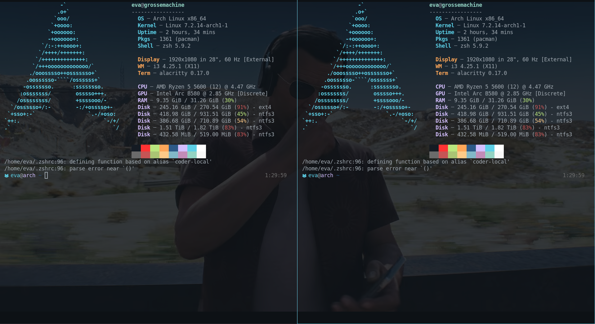

# live-fullscreen-wallpaper

Put a YouTube video fullscreen in Firefox/Chromium/Brave and it also plays as your **live wallpaper**, visible behind your transparent terminals on the other workspaces.

- YouTube fullscreen: the video plays on the desktop layer (muted, same position as the browser, 720p).
- Any other fullscreen window (a game...): black wallpaper.
- No fullscreen: your normal wallpaper comes back.




## Requirements

i3 on X11, a compositor ([picom](https://github.com/yshui/picom)) and transparent windows (e.g. alacritty `opacity = 0.85`), plus `mpv yt-dlp feh playerctl python-i3ipc python-xlib`. 

**Hyprland / Omarchy**: `live-fullscreen-wallpaper-hyprland.py` (Wayland, via `mpvpaper`), set up by `install.sh` when run inside a Hyprland session. Needs `mpv yt-dlp playerctl mpvpaper`, no picom. Untested on real Omarchy so far. Sway and GNOME/KDE are not supported.

## Install

```sh
git clone https://github.com/evaspace/live-fullscreen-wallpaper
cd live-fullscreen-wallpaper
./install.sh ~/Pictures/my-wallpaper.png   # pacman / apt / dnf / zypper
```

It adds one `exec_always` line to your i3 config. Reload i3 with `Mod+Shift+r`.
Let an AI agent do it for you: see [AI_INSTALL.md](AI_INSTALL.md), or copy `skill/` to `~/.claude/skills/live-fullscreen-wallpaper/` for Claude Code.

## How it works

1. i3ipc watches window events and finds a fullscreen browser window titled `... - YouTube`.
2. `playerctl` (MPRIS) gives the exact video URL and playback position.
3. `yt-dlp` resolves the stream, `mpv` plays it from the same position in a borderless `_NET_WM_WINDOW_TYPE_DESKTOP` window under everything. picom paints the root pixmap, not the root window, so a real window is needed.

## Limits

- Startup takes a few seconds (yt-dlp extraction). Sync is approximate and drifts over time.
- Without MPRIS data it falls back to a title search and may play another video.
- The i3/X11 live mode crashed Xorg once on an Intel Arc GPU (Mesa glamor). Disable it with `LFW_LIVE=0` if it happens to you (fullscreen then gives a black wallpaper).
- Logs: `/tmp/live-fullscreen-wallpaper.log` and `/tmp/live-fullscreen-wallpaper-mpv.log`.

MIT license.
